# PREVENT-X: Academic & Evaluation Demonstration Guide
## Reproducible 15-Minute Demonstration Protocol for College Project Defense & Live Evaluation

**Project**: PREVENT-X — Autonomous AI-Era Cyber Defense & Virtual Patching Platform  
**Audience**: Academic Review Board, Project Evaluators & Cybersecurity Examiners  
**Evaluation Time**: 15–20 minutes  
**Prerequisites**: Active PREVENT-X backend (`:8000`), frontend (`:3000`), PostgreSQL (`:54320`), Redis (`:6379`), and Celery worker.

---

## 1. Executive Demonstration Narrative

PREVENT-X addresses the critical cybersecurity crisis facing Indian Small and Medium Businesses (SMBs): the **45-to-90-day vulnerability patching lag** that leaves digital businesses exposed to automated cyberattacks. This demonstration shows how PREVENT-X autonomously discovers weaknesses, maps attack paths, synthesizes virtual patches, validates them in staging, deploys them with human authorization to a live Nginx reverse proxy, blocks active exploits in real time, and executes verified rollbacks without touching application source code.

---

## 2. Step-by-Step 10-Phase Demonstration Sequence

```mermaid
flowchart LR
    PhaseA["1. Login & Posture"] --> PhaseB["2. Discovery"]
    PhaseB --> PhaseC["3. CVE Mapping"]
    PhaseC --> PhaseD["4. Attack Paths"]
    PhaseD --> PhaseE["5. Zero Trust"]
    PhaseE --> PhaseF["6. Virtual Patch & Staging"]
    PhaseF --> PhaseG["7. Human Approval & Deploy"]
    PhaseG --> PhaseH["8. Live Exploit Block"]
    PhaseH --> PhaseI["9. Event Correlation (T1190)"]
    PhaseI --> PhaseJ["10. Containment & Rollback"]
```



---

### Phase A: System Login & Executive Security Center (2 Minutes)

1. Open your browser and navigate to the PREVENT-X Portal: `http://localhost:3000`.
2. Log in using the authorized tenant administrator credentials:
   - **Email**: `admin@alphafintech.in`
   - **Password**: `AlphaAdminPass123!`
3. **What to Point Out to Evaluators**:
   - The unified **Security Center** (`/security-center`) displays an executive-level **Security Posture Score** (0–100 scale) and security grade (A through F).
   - Core operational KPIs: Open Critical Incidents, WAF Blocks in Last 24 Hours, Vulnerabilities in Active Attack Paths, and Zero Trust Compliance.
   - CERT-In compliance telemetry: Chronological timeline ready for 6-hour statutory reporting.

---

### Phase B: Asset Inventory & Controlled Attack Surface Discovery (2 Minutes)

1. In the sidebar, navigate to **Asset Management** (`/assets`).
2. Show registered SMB assets:
   - `Payment Gateway API` (`127.0.0.1:8086`, Criticality: `CRITICAL`).
   - `Customer Web Portal` (`alphafintech.in`, Criticality: `HIGH`).
3. Navigate to **Attack Surface Intelligence** (`/attack-surface`).
4. Click **"Run Controlled Discovery"**:
   - Demonstrate the mandatory authorization gate (requires explicit permission and defined port scope `[8086]`).
   - Show empirical evidence capture: open port status, HTTP Server header, and TLS certificate metadata.
   - Explain the `SafePinningBackend` connection-level socket pinning mechanism that prevents SSRF and DNS rebinding attacks.

---

### Phase C: Vulnerability Intelligence & CVE/CWE Mapping (1.5 Minutes)

1. Navigate to **Vulnerability Mapping** (`/vulnerabilities`).
2. Show the mapped vulnerability record:
   - **ID**: `CVE-2023-4567` | **Weakness**: `CWE-89 (SQL Injection)`.
   - **Target**: `Payment Gateway API` (`/api/v1/checkout`).
   - **Threat Metrics**: CVSS v3.1: `9.8 Critical` | EPSS Score: `0.94` (Top 1% exploitation likelihood) | CISA KEV: `Known Exploited`.
3. **Key Evaluator Insight**: Point out that PREVENT-X does not just show raw CVE lists; it correlates vulnerability intelligence with discovered running services to calculate an empirical contextual risk score.

---

### Phase D: Evidence-Backed Attack Path Graph Traversal (2 Minutes)

1. Navigate to **Attack Paths** (`/attack-paths`).
2. Open the identified attack path: `PATH-Payment_Gateway_API-TO-Payment_Gateway_API`.
3. Show the interactive Directed Acyclic Graph (DAG):
   - Entry point: Internet-facing checkout endpoint.
   - Intermediate choke point: Unsanitized query parameter.
   - Target crown jewel: Payment processing database.
4. Point out the **MITRE ATT&CK Mapping**: Technique `T1190: Exploit Public-Facing Application`.
5. Point out the **Prevention Recommendation**:
   - `Deploy Virtual Patch Rule for CVE-2023-4567 on Payment Gateway API`.
   - Category: `VIRTUAL_PATCH`, Risk Reduction: `HIGH`, Implementation Complexity: `LOW`.

---

### Phase E: Zero Trust Security Evaluation (1.5 Minutes)

1. Navigate to **Zero Trust Security** (`/zero-trust`).
2. Show the continuous trust evaluation matrix:
   - Assets are evaluated across Identity, Network Exposure, Vulnerability Posture, and Access Control.
   - Assets with unpatched critical CVEs are classified as **`RESTRICTED`** or **`UNTRUSTED`** (never implicitly trusted).
   - Show actionable Least-Privilege Policy Recommendations (e.g. enforce strict reverse-proxy inspection and IP rate limiting).

---

### Phase F: Virtual Patch Synthesis & Staging Validation (2 Minutes)

1. Navigate to **Virtual Patching** (`/virtual-patches`).
2. Show the synthesized compensating rule:
   - **Rule Name**: `PREVENTX-SQLI-CHECKOUT-PROTECTION`.
   - **Attack Type**: `SQL Injection (SQLI)`.
   - **Target URI**: `/api/v1/checkout`.
   - **Match Condition**: Regex pattern `union\s+select` in `QUERY_STRING`.
   - **Action**: `BLOCK (403 Forbidden)`.
3. Click **"Stage Deployment"**:
   - Shows the generated native Nginx configuration.
   - Emphasize the automated syntax validation gate (`nginx -t`) executed before saving.
4. Navigate to **Security Validation** (`/security-validation`) and trigger a validation job:
   - PREVENT-X runs its non-destructive **21-test security suite** against the staging proxy.
   - Show the 100% pass rate: SQLi blocked, XSS blocked, path traversal blocked, and benign requests allowed.

---

### Phase G: Production Human-in-the-Loop Approval (1 Minute)

1. Return to **Virtual Patching** (`/virtual-patches`).
2. Demonstrate the **Human Authorization Gate**:
   - The platform strictly refuses to deploy unapproved rules to production.
   - Click **"Approve Deployment"** as `admin@alphafintech.in`.
   - Show the recorded approval timestamp and operator ID in the deployment audit log.
3. Click **"Deploy to Production"**:
   - PREVENT-X acquires a distributed PostgreSQL advisory lock.
   - Live Nginx reloads its configuration with zero downtime (`nginx -s reload`).

---

### Phase H: Live Exploit Blocking vs Benign Traffic (2 Minutes)

Execute live requests via the terminal or Postman against the reverse proxy (`http://127.0.0.1:8085`):

#### 1. Benign Customer Checkout (Allowed — 200 OK)
```bash
curl -i "http://127.0.0.1:8085/api/v1/checkout?item=1001&qty=2"
```
**Expected Output**:
```http
HTTP/1.1 200 OK
Content-Type: application/json
X-Upstream-Service: SecurePay-Backend

{"status": "PROCESSED", "message": "Payment processing business logic executed safely."}
```
*Result: Legitimate customer traffic flows through uninterrupted.*

#### 2. Malicious SQL Injection Attack (Blocked — 403 Forbidden)
```bash
curl -i "http://127.0.0.1:8085/api/v1/checkout?item=1001'+UNION+SELECT+1,2,3--"
```
**Expected Output**:
```http
HTTP/1.1 403 Forbidden
Content-Type: text/html
Server: nginx

<html>
<head><title>403 Forbidden - Blocked by PREVENT-X Virtual Patch</title></head>
...
```
*Result: Exploit terminated instantly at reverse proxy boundary without reaching the upstream payment backend!*

---

### Phase I: Real-Time Event Ingestion & MITRE Correlation (1.5 Minutes)

1. Return to **Security Center** (`/security-center`).
2. Show the live **Security Events Feed**:
   - Real-time event recorded: `WAF Blocked SQL Injection Attempt` from attacker IP `198.51.100.22`.
3. Show the automated **Incident Correlation**:
   - Repeated probes from the hostile IP are correlated into **`INC-2026-0002`**.
   - Severity: `CRITICAL` | MITRE Technique: `T1190 (Exploit Public-Facing Application)`.
   - Posture Score dynamically updates to reflect active threat pressure.

---

### Phase J: Authorized Containment & Reliable Atomic Rollback (2 Minutes)

1. In the Incident Details panel, click **"Execute Containment"**:
   - Action: `BLOCK_SOURCE_IP`.
   - Status updates immediately to **`CONTAINED`** with operator sign-off.
2. Navigate to **Security Validation** (`/security-validation`) -> **Rollback Manager**:
   - Click **"Execute Rollback"** to return to the verified clean baseline.
   - PREVENT-X verifies the SHA-256 integrity checksum of the baseline configuration snapshot.
   - Nginx reloads the clean baseline with zero dropped connections.
3. Test traffic again to show continuous 200 OK service uptime:
```bash
curl -i "http://127.0.0.1:8085/api/v1/checkout?item=1001"
# Returns HTTP/1.1 200 OK
```

---

## 3. Evaluator Q&A Cheatsheet (Academic Defense)

| Common Examiner Question | PREVENT-X Architectural Answer |
| :--- | :--- |
| **Why not just fix the code instead of virtual patching?** | Fixing production source code requires code rewrites, testing, and deployment cycles that average 45-90 days for SMBs. Virtual patching acts as an immediate zero-downtime compensating control that stops exploitation *today* while developers patch *safely*. |
| **How do you prevent a bad rule from breaking the site?** | Through a 3-layer safety gate: (1) Native `nginx -t` pre-reload syntax validation, (2) automated staging validation running 21 non-destructive test probes, and (3) automated rollback with SHA-256 snapshot verification if failure thresholds are breached. |
| **Is the AI hallucinating rules?** | No. Rule synthesis is deterministic AST pattern compilation derived from formal CVE/CWE indicators and HTTP URI match specifications. AI is used strictly for contextual risk scoring and statistical anomaly detection (Z-scores). |
| **How does PREVENT-X handle multi-tenancy?** | Strict tenant isolation via `TenantScopedRepositoryBase` (all SQL queries scoped by `organization_id`), isolated JWT tenant claims, and independent PostgreSQL advisory locks per application port. |
| **How does this help with Indian law (DPDP / CERT-In)?** | Implements technical safeguards required by DPDP Section 8(5) to prevent personal data breaches, and provides automated 6-hour incident aggregation with 180-day immutable audit logs under CERT-In directives. |

---

## 4. Evaluation Rubric & Feature Mapping

| Project Grading Criterion | PREVENT-X Implementation | Demonstrated In |
| :--- | :--- | :--- |
| **Architectural Complexity** | 12 integrated modules, microservices, asynchronous Celery queues, PostgreSQL advisory locks, Redis pub/sub, native Nginx proxy | Phases A, G, H |
| **Security & Cryptography** | Connection-level IP pinning (`SafePinningBackend`), bcrypt passwords, JWT authentication, SHA-256 integrity hashes, SSRF defenses | Phases B, G, J |
| **Real-Time Data Processing** | Nginx structured log parsing, Server-Sent Events (SSE), sliding-window event aggregation, dynamic security score calculation | Phases H, I |
| **Reliability & Fault Tolerance** | Pre-deployment staging validation, automated auto-rollback, zero-downtime Nginx reloads, distributed deployment locking | Phases F, G, J |
| **Industry & Social Relevance** | Solves critical cyber threat and DPDP compliance challenges for Indian SMB digital businesses with zero application code modification | Phases A, C, J |
