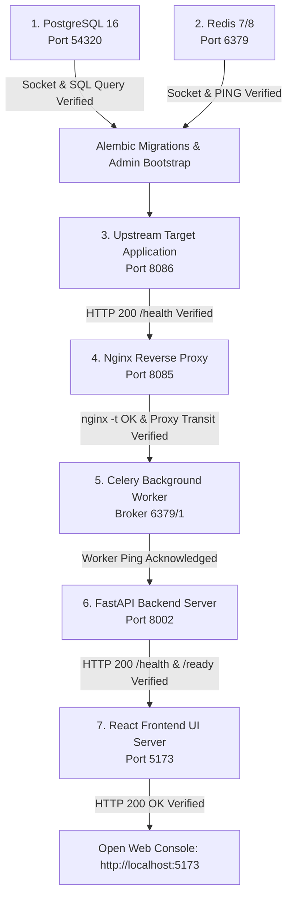

# PREVENT-X: Security Testing Lab Operations & Architecture Guide

**Platform Version**: 1.0.0 (Phase 9 Release)  
**Research Alignment**: NASSCOM Applied Research Bridge 2.0 — Problem Statement 5 (*"AI-Era Virtual Patching for Security Protection of Indian SMB Digital Businesses"*)  
**Execution Environment**: Native Microsoft Windows 11 / Windows Server (Standalone, Non-Containerized)  
**Primary Interface**: Single-Click Master Launcher (`start.bat`) with Automatic Cleanup on Exit & Wi-Fi Support

---

## 1. Executive Overview

PREVENT-X is an enterprise-grade cybersecurity platform engineered to protect small and medium-sized digital businesses (SMBs) from zero-day exploits and web application vulnerabilities through deterministic, intelligent virtual patching.

The **PREVENT-X Security Testing Lab** provides a self-contained, isolated local attack-testing environment. In this lab, security engineers and authorized penetration testers can:
1. Discover assets and weak application interfaces across the attack surface.
2. Synthesize AI/deterministic compensating controls (WAF rules) from CVE/CWE flaws.
3. Validate rules in real time through an embedded **Nginx Reverse Proxy** acting as an inline Web Application Firewall (WAF).
4. Direct controlled exploit payloads (such as SQL Injection, Cross-Site Scripting, and Path Traversal) through the reverse proxy to empirically verify blocking (`403 Forbidden`) without impacting legitimate upstream business logic (`200 OK`).

---

## 2. Platform Architecture & Service Roles

The PREVENT-X lab consists of seven coordinated services running natively on Windows:

| # | Service | Native Binary / Runtime | Configured Port | Purpose |
| :- | :--- | :--- | :--- | :--- |
| **1** | **PostgreSQL Database** | `infrastructure/bin/postgres/bin/postgres.exe` | `54320` | Multi-tenant relational database storing assets, vulnerabilities, virtual patch rules, version history, audit logs, and security incidents. Data directory: `data/pgdata`. |
| **2** | **Redis Cache & Broker** | `infrastructure/bin/redis/redis-server.exe` | `6379` | In-memory key-value store powering session caching (DB 0), Celery task broker queues (DB 1), and Celery task result storage (DB 2). Data snapshot: `dump.rdb`. |
| **3** | **Upstream Target App** | `scripts/run_upstream_app.py` (Python 3.10) | `8086` | Simulated SMB business backend (e.g., payment checkout, user profile). Serves as the protected target behind the Nginx reverse proxy. Bound to `127.0.0.1`. |
| **4** | **Nginx Virtual Patch Proxy** | `infrastructure/bin/nginx/nginx.exe` | `8085` | High-performance reverse proxy running the PREVENT-X active WAF ruleset (`preventx_active.conf`). Inspects inbound HTTP traffic, blocks matching attack patterns, and forwards safe traffic to port `8086`. |
| **5** | **Celery Background Worker**| `celery.exe` via `.venv` (Pool: `solo`) | N/A (Broker `6379`) | Asynchronous job worker processing active vulnerability scans, virtual patch compilation, staging validation suites, and event correlation pipelines. |
| **6** | **FastAPI Backend API** | `uvicorn` / `backend.app.main:app` | `8002` | Core PREVENT-X API engine managing multi-tenant RBAC, asset discovery, CVE mapping, attack graph analysis, virtual patch governance, and security incident correlation. |
| **7** | **React Frontend UI** | `vite` / React 18 SPA (TypeScript) | `5173` | Rich interactive dashboard for security analysts and SMB administrators. Proxies all `/api/*` network requests directly to the FastAPI backend on port `8002`. |

---

## 3. Network Port Mapping & Binding

All network services are strictly bound to loopback interfaces (`127.0.0.1` / `localhost`) where supported to prevent accidental exposure to external network interfaces during attack testing:

```
+---------------------------------------------------------------------------------------------------+
|                                 PREVENT-X LOCAL TESTING LAB                                       |
|                                                                                                   |
|  [Browser User]                   [Security Tester / Burp Suite]                                  |
|         │                                      │                                                  |
|         ▼                                      ▼                                                  |
|   Port 5173 (Vite UI)                    Port 8085 (Nginx Reverse Proxy & Virtual Patching)        |
|         │                                      │                                                  |
|         ▼ (Proxy: /api)                        ├───────────────┬──────────────────┐               |
|   Port 8002 (FastAPI Engine)                   ▼               ▼                  ▼               |
|         │                               Legitimate Req   Malicious SQLi      Malicious XSS        |
|         ├──────────────┬─────────────┐  (200 OK)         (403 Blocked)       (403 Blocked)        |
|         ▼              ▼             ▼         │                                                  |
|    Port 54320      Port 6379    Celery Solo    ▼                                                  |
|    (PostgreSQL)     (Redis)      (Worker)  Port 8086 (Upstream Business Target)                   |
+---------------------------------------------------------------------------------------------------+
```

---

## 4. Startup Sequence & Dependency Management

Services must start in a strict sequence because downstream services depend on the availability and health of upstream infrastructure:



### Invariant Checks Prior to Activation:
1. **Port Availability**: The startup orchestrator checks whether each port is already listening. If an instance of the service is already healthy, it is reused without launching redundant processes.
2. **Database Schema Sync**: Alembic migrations (`upgrade head`) execute automatically against port `54320`.
3. **Nginx Syntax Gate**: `nginx.exe -p <prefix> -c <config> -t` is executed *before* starting Nginx. If syntax errors exist, startup immediately halts with a descriptive error.
4. **End-to-End Transit Verification**: Nginx is tested by sending a request to `http://127.0.0.1:8085/api/v1/checkout`. If Nginx cannot communicate with Upstream on port `8086`, startup reports a fatal failure.

---

## 5. Quick Start Instructions (`start.bat`)

### Starting the Lab (Single-Click Automation)
Double-click `start.bat` in Windows Explorer, or execute from PowerShell / Command Prompt:

```cmd
start.bat
```

The unified launcher will:
- Check Python `.venv` and Node.js prerequisites.
- Automatically detect the active Wi-Fi / Local Network IPv4 address (e.g., `10.13.135.87`).
- Launch all 7 services in strict dependency order:
  1. PostgreSQL (port `54320`)
  2. Redis (port `6379`)
  3. Upstream Mock Business App (port `8086`, bound to `0.0.0.0`)
  4. Nginx Reverse Proxy & Virtual Patching Engine (port `8085`, bound to `0.0.0.0`)
  5. Celery Asynchronous Worker
  6. FastAPI Backend API (port `8002`, bound to `0.0.0.0`)
  7. React Frontend UI (port `5173`, bound to `0.0.0.0`)
- Run the automated 10-point health audit suite (`check_lab.py`).
- Display dedicated titled console windows for monitoring live logs.
- Save runtime process PIDs to `logs/lab_pids.json`.
- Open the web console automatically at `http://localhost:5173`.
- Display the complete operational banner showing both **Local** and **Network (Wi-Fi)** access URLs.

### Local & Network (Wi-Fi) Access
All services bind to `0.0.0.0` and allow cross-device network access:
- **Local Access (This Computer)**:
  - Frontend UI: `http://localhost:5173`
  - Backend API: `http://127.0.0.1:8002`
  - Interactive Docs: `http://127.0.0.1:8002/api/v1/docs`
  - Virtual Patch Proxy: `http://127.0.0.1:8085`
  - Upstream Test Target: `http://127.0.0.1:8086`
- **Network / Wi-Fi Access (Mobile / Other PC on Same Network)**:
  - Frontend UI: `http://<Wi-Fi-IP>:5173` (e.g. `http://10.13.135.87:5173`)
  - Backend API: `http://<Wi-Fi-IP>:8002`
  - Interactive Docs: `http://<Wi-Fi-IP>:8002/api/v1/docs`
  - Virtual Patch Proxy: `http://<Wi-Fi-IP>:8085`
  - Upstream Test Target: `http://<Wi-Fi-IP>:8086`

---

## 6. Verifying Lab Health (`check_lab.py`)

The health audit suite runs automatically every time `start.bat` is launched. You can also run it manually at any time using:

```cmd
python scripts\check_lab.py
```

This utility executes 10 independent verification checks and outputs a color-coded PASS/FAIL table:

```
====================================================================================================
                      PREVENT-X SECURITY TESTING LAB HEALTH VERIFICATION                     
====================================================================================================
Service                      Port / Target                Status     Latency    Details
----------------------------------------------------------------------------------------------------
PostgreSQL Database          127.0.0.1:54320              [PASS]     2.5ms      SQL query OK (users: 9)
Redis Cache & Broker         127.0.0.1:6379               [PASS]     1.2ms      PONG received (broker operational)
FastAPI Backend (Health)     127.0.0.1:8002/api/v1/health [PASS]     14.8ms     status: HEALTHY (v1.0.0)
FastAPI Backend (Ready)      127.0.0.1:8002/api/v1/ready  [PASS]     11.3ms     database: UP, redis: UP
Celery Background Worker     redis://localhost:6379/1     [PASS]     32.1ms     Worker active (celery@LAPTOP...)
Upstream Test App            127.0.0.1:8086/health        [PASS]     2.9ms      HTTP 200 OK (service ready)
Nginx Virtual Patch Proxy    127.0.0.1:8085/              [PASS]     3.8ms      HTTP 200 OK (nginx active)
Nginx-to-Upstream Transit    127.0.0.1:8085 -> :8086      [PASS]     5.4ms      Traffic forwarded successfully
Virtual Patch Enforcement    127.0.0.1:8085 (SQLi Test)   [PASS]     4.2ms      HTTP 403 Blocked (Attack: SQLI)
React Frontend UI            localhost:5173/              [PASS]     7.1ms      HTTP 200 OK (Vite SPA Ready)
----------------------------------------------------------------------------------------------------
OVERALL STATUS: PASS — ALL 10 CHECKS OPERATIONAL (10/10)
====================================================================================================
```

*Exit Codes*: Returns `0` if all tests pass; returns `1` if any test fails.

---

## 7. Automatic Graceful Lab Shutdown

**No extra stop batch file is needed!**
The entire lab lifecycle is controlled directly from the `start.bat` window:

1. **Press [ENTER] or Ctrl+C in `start.bat`**: Triggers immediate graceful shutdown of all services and console windows.
2. **Closing the `start.bat` window (clicking `X`)**: An automatic background watchdog detects the window closure and triggers `scripts/stop_lab.ps1` within milliseconds to guarantee zero orphaned processes.
3. **Manual CLI shutdown (if ever needed)**:
   ```cmd
   powershell scripts\stop_lab.ps1
   ```

### Safety Guarantees:
- **No Indiscriminate Termination**: Uses tracked process IDs (`logs/lab_pids.json`) and specific port/command-line ownership verification. Does **NOT** execute blind `taskkill /IM python.exe` or kill unrelated developer processes.
- **Graceful Web Server Shutdown**: Stops Nginx using `nginx -s stop` to cleanly close socket descriptors and flush logs.
- **Data Preservation**: PostgreSQL database (`data/pgdata`) and Redis snapshots (`dump.rdb`) are preserved 100% intact.
- **Optional Infrastructure Stop**: By default, PostgreSQL and Redis remain running so subsequent startups are instantaneous. Running `powershell scripts\stop_lab.ps1 -StopAll` will shut down PostgreSQL and Redis gracefully as well using `pg_ctl stop -m fast` and `redis-cli shutdown save`.

---

## 8. Burp Suite Integration & Attack-Testing Guide

### Architecture of the Interception Flow
In this testing lab, the Nginx reverse proxy on port `8085` serves as the live Virtual Patching enforcement point protecting the upstream target application on port `8086`.

```
[Attacker / Burp Suite] ──(Port 8085)──> [Nginx Virtual Patch Proxy] ──(Port 8086)──> [Upstream Target App]
                                                    │
                                                    ├── Malicious Pattern? ──> [403 Forbidden Response]
                                                    └── Clean Request?     ──> [Proxy to :8086 -> 200 OK]
```

### Scenario A: Direct Testing with Burp Suite (Repeater / Intruder)
1. Open Burp Suite.
2. In Burp Repeater, configure the target:
   - **Host**: `127.0.0.1`
   - **Port**: `8085`
   - **Protocol**: `HTTP`

#### 1. Legitimate Request Test:
Send a normal business request:
```http
GET /api/v1/checkout?item=1001&qty=2 HTTP/1.1
Host: 127.0.0.1:8085
User-Agent: Mozilla/5.0
```
**Expected Response**:
```http
HTTP/1.1 200 OK
Server: nginx
Content-Type: application/json
X-Upstream-Backend: PreventX-Mock-App
X-WAF-Engine: PREVENT-X-Intelligent-WAF

{
  "status": "PROCESSED",
  "service": "SecurePay-Backend",
  "path": "/api/v1/checkout?item=1001&qty=2",
  "message": "Payment processing business logic executed safely."
}
```

#### 2. SQL Injection Attack Test:
Send a SQL Injection payload targeting the query parameter:
```http
GET /api/v1/checkout?item=1001'+UNION+SELECT+1,2,3-- HTTP/1.1
Host: 127.0.0.1:8085
User-Agent: Mozilla/5.0
```
**Expected Response**:
```http
HTTP/1.1 403 Forbidden
Server: nginx
Content-Type: application/json
X-WAF-Blocked: 1
X-WAF-Rule-ID: ee413bae-7460-4353-a712-9072107eb4e4
X-WAF-Attack-Type: SQLI

{
  "error": "Forbidden",
  "waf_blocked": true,
  "rule_id": "ee413bae-7460-4353-a712-9072107eb4e4",
  "attack_type": "SQLI",
  "incident_timestamp": "2026-11-15T16:52:54+05:30"
}
```

#### 3. Cross-Site Scripting (XSS) Attack Test:
```http
GET /api/v1/checkout?search=<script>alert(1)</script> HTTP/1.1
Host: 127.0.0.1:8085
```
**Expected Response**: `403 Forbidden` (`X-WAF-Attack-Type: XSS`).

#### 4. Path Traversal Attack Test:
```http
GET /../../etc/passwd HTTP/1.1
Host: 127.0.0.1:8085
```
**Expected Response**: `403 Forbidden` (`X-WAF-Attack-Type: PATH_TRAVERSAL`).

#### 5. Command Injection Attack Test:
```http
GET /api/v1/checkout?id=1;whoami HTTP/1.1
Host: 127.0.0.1:8085
```
**Expected Response**: `403 Forbidden` (`X-WAF-Attack-Type: CMDI`).

#### 6. Automated Scanner Filtering Test:
Send a request with an automated vulnerability scanner user-agent:
```http
GET /api/v1/checkout HTTP/1.1
Host: 127.0.0.1:8085
User-Agent: sqlmap/1.7#stable
```
**Expected Response**: `403 Forbidden` (`X-WAF-Attack-Type: PATTERN_BLOCK`).

---

### Scenario B: Browser Navigation via Burp Suite Proxy
1. In Burp Suite, ensure Proxy Listener is active on `127.0.0.1:8080`.
2. Configure your browser or use Burp's embedded browser to route traffic through `127.0.0.1:8080`.
3. In the browser, navigate to:
   - Protected Web Application via Virtual Patch: `http://127.0.0.1:8085/`
   - PREVENT-X Web Console: `http://localhost:5173/`
4. In Burp Suite Proxy -> HTTP History, observe how every request hitting port `8085` is evaluated by Nginx. Inbound attack payloads trigger immediate 403 blocks with full forensic audit headers.

---

## 9. Security & Secrets Management

1. **Zero Plaintext Credential Output**: The startup scripts and utilities never display passwords, tokens, or JWTs on screen.
2. **Administrator Account**:
   - Initial Platform Admin Email: `admin@preventx.internal`
   - Configured via environment variables (`INITIAL_ADMIN_EMAIL`, `INITIAL_ADMIN_PASSWORD`).
   - **MANDATORY**: Administrators must rotate default passwords immediately upon initial login via Settings -> Account Security or the User Provisioning API.
3. **Loopback Isolation**: Testing ports `8085` and `8086` are bound to `127.0.0.1`. Do not bind proxy testing ports to `0.0.0.0` on untrusted networks without authentication.
4. **Environment Isolation**: `.env` is loaded automatically by the backend without overwriting system environment variables. Never commit production secrets to Git.

---

## 10. Troubleshooting & Common Issues

| Issue | Root Cause | Resolution |
| :--- | :--- | :--- |
| **Port 54320 Occupied** | Stale or external PostgreSQL instance. | Run `powershell scripts\stop_lab.ps1 -StopAll`. If another application uses 54320, adjust `DATABASE_URL` in `.env`. |
| **Port 8002 Unreachable** | Backend failed during startup or migration. | Inspect `logs/startup.log` and the `PREVENT-X Backend API` console window for traceback details. |
| **Nginx Syntax Error** | Invalid Nginx directive in active configuration. | Run `infrastructure/bin/nginx/nginx.exe -p infrastructure/bin/nginx -c conf/preventx_active.conf -t` to identify invalid lines. |
| **Nginx Error: "OpenEvent ngx_reload failed"** | Stale PID recorded in `logs/nginx.pid`. | The startup script automatically purges stale PID files. To fix manually: delete `infrastructure/bin/nginx/logs/nginx.pid` and re-run `start.bat`. |
| **Port 8086 Connection Refused** | Upstream test application crashed or exited. | Inspect `logs/upstream_app.log` or restart it via `call scripts/run_upstream_app.bat 8086`. |
| **Celery Ping Timeout** | Redis broker not running on port 6379. | Verify Redis connectivity via `redis-cli -p 6379 ping`. Ensure Redis is running before launching Celery. |

---

## 11. Artifacts & Log Files

All diagnostic logs and runtime state manifests are centralized in the `logs/` directory:
- `logs/startup.log`: Timestamped log of the complete automated startup sequence.
- `logs/upstream_app.log`: HTTP request log for the mock business application on port 8086.
- `logs/lab_pids.json`: Runtime process tracking manifest for graceful shutdowns.
- `infrastructure/bin/nginx/logs/access.log`: Nginx reverse proxy access log.
- `infrastructure/bin/nginx/logs/error.log`: Nginx reverse proxy operational and error log.
