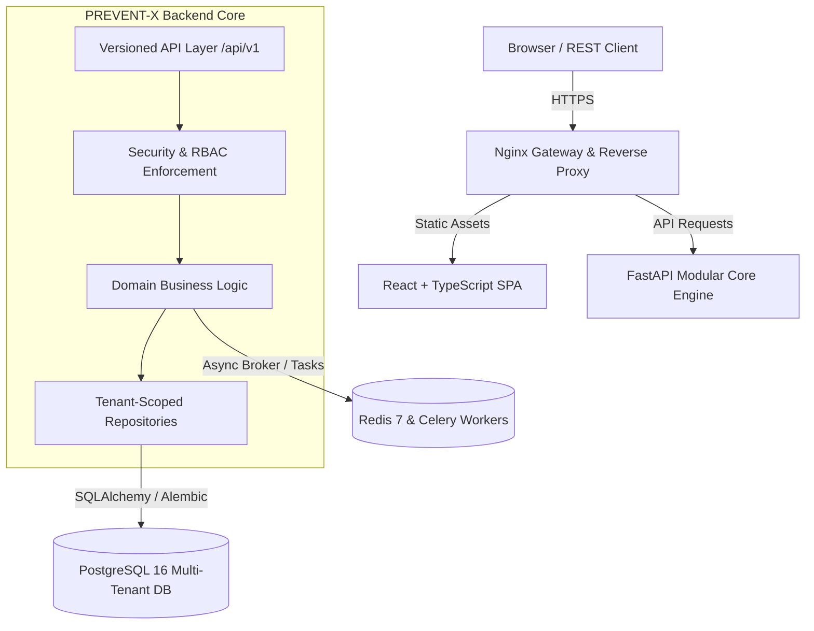

# PREVENT-X System Architecture Overview

## 1. Problem Context & Purpose
PREVENT-X is an enterprise cybersecurity virtual patching platform developed in response to **NASSCOM Applied Research Bridge 2.0 (Problem Statement 5: "AI-Era Virtual Patching for Security Protection of Indian SMB Digital Businesses")**.

Indian Small and Medium Businesses (SMBs) operate under acute real-world constraints:
- **Severe cybersecurity staffing shortages** (frequently zero dedicated SecOps personnel).
- **Cost sensitivity** preventing deployment of heavyweight enterprise appliances.
- **Fragmented, legacy technology stacks** across PHP, Java, Node.js, Python, and legacy CMS platforms.
- **Low tolerance for operational downtime** and false-positive blocks.
- **Intermittent connectivity** across regional infrastructure.

PREVENT-X addresses this challenge by providing an intelligent, multi-tenant virtual patching architecture that compensates for software vulnerabilities at the perimeter and middleware layers—eliminating the need for emergency code modifications or server restarts.

---

## 2. Core Architectural Principles

### Architectural Separation
1. **API Layer (`backend/app/api/v1/`)**: Pure request validation, route handling, and HTTP response serialization using Pydantic v2 models. No direct business logic or raw SQL queries.
2. **Security & RBAC Layer (`backend/app/security/`)**: Argon2id password verification, session token validation, tenant scope enforcement, and granular permission checking.
3. **Business Logic Layer (`backend/app/services/`)**: High-level domain orchestration, admin bootstrap, asset lifecycle management, and audit event dispatch.
4. **Data Access Layer (`backend/app/repositories/`)**: Abstracted repository pattern enforcing tenant isolation filters (`where organization_id = :org_id`) on all queries.
5. **Database Layer (`backend/app/models/`)**: Declarative SQLAlchemy models with UUID primary keys, foreign-key referential integrity, and Alembic database migrations.
6. **Background Task Processing (`backend/app/workers/`)**: Redis-backed Celery worker processing asynchronous background jobs, session cleanups, and telemetry.
7. **Frontend Presentation (`frontend/src/`)**: Componentized React 18 SPA built with TypeScript, Tailwind CSS, and Lucide icons.
