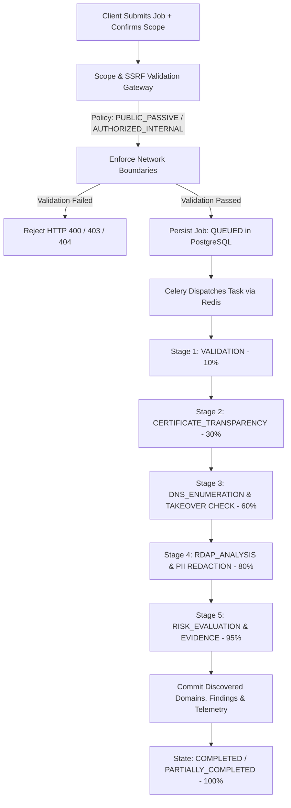

# PREVENT-X — Attack Surface Discovery Workflow

## 1. Complete Step-by-Step Discovery Lifecycle

The attack surface discovery pipeline moves through a deterministic state machine managed by `DiscoveryManager`.

---

## 2. Detailed Execution Stages

### Stage 1: Validation (10% Progress)
- **Objective**: Ensure that runtime boundaries have not been tampered with and target remains authorized.
- **Actions**:
  1. Verifies asset belongs to active tenant organization.
  2. Verifies `is_in_scope == True`.
  3. Verifies `authorization_confirmed == True`.
  4. Enforces policy boundaries (`PUBLIC_PASSIVE` rejects private IPs; `AUTHORIZED_INTERNAL` requires registered internal asset and `discovery:internal` permission).
  5. Checks if user flagged job for cancellation.

### Stage 2: Certificate Transparency Logs (30% Progress)
- **Objective**: Uncover external subdomains and wildcards without sending direct network packets to the customer's hosts.
- **Provider**: `CertificateTransparencyAdapter` querying `crt.sh` through `SSRFDefense.create_safe_client`.
- **Telemetry Collected**:
  - `common_name` and multi-line Subject Alternative Names (`SANs`).
  - Issuer CA name and serial number.
  - Validity range (`not_before`, `not_after`).
  - Wildcard detection (`*.domain`).
  - Deduplicated list of discovered subdomains matching the target scope.
- **Resilience**: If `crt.sh` experiences network timeout or 502/504 errors, the stage retries, records a non-fatal warning in `stage_errors` upon exhaustion, and proceeds to DNS rather than crashing.

### Stage 3: DNS Enumeration & Takeover Analysis (60% Progress)
- **Objective**: Resolve records, inspect email security posture, and classify resource takeover pointers non-intrusively.
- **Provider**: `DNSIntelligenceAdapter` using `dnspython`.
- **Telemetry Collected**:
  - `A` and `AAAA` records: categorized into public routable vs private RFC 1918 addresses.
  - `CNAME` records: analyzed for third-party cloud hosting patterns (AWS S3, Azure, GitHub Pages, Heroku, etc.).
  - **Non-Intrusive NXDOMAIN Takeover Check**: Unresolved CNAME aliases pointing to cloud providers are classified as `VERIFIED_UNCLAIMED_RESOURCE`.
  - `MX` and `NS` records: identifies mail routing and authoritative nameservers.
  - `TXT` records: parses SPF (`v=spf1 ...`) on domain apex.
  - DMARC record: queries `_dmarc.<domain>` for `v=DMARC1 ...`.

### Stage 4: RDAP Analysis & Privacy Preservation (80% Progress)
- **Objective**: Retrieve authoritative registrar information and domain registration timelines while guaranteeing privacy.
- **Provider**: `RDAPAdapter` querying ICANN RDAP bootstrap through `SSRFDefense.create_safe_client`.
- **Privacy Preservation**:
  - Personal contact details (registrant names, individual emails, telephone numbers, postal addresses) are strictly redacted.
  - Only institutional data is preserved: registrar name, whois server, registration date, expiration date, and nameservers.

### Stage 5: Risk Evaluation & Findings Generation (95% Progress)
- **Objective**: Evaluate mathematical exposure risk and generate categorized evidence records.
- **Engines**: `DeterministicRiskEngine` + `EvidenceManager`.
- **Actions**:
  1. Computes explainable 0–100 Exposure Risk Score across 6 distinct weighted factors (summing exactly to 100.0).
  2. Tags each finding with one of the 5 standardized categories (`ATTACK_SURFACE_EXPOSURE`, `EMAIL_SECURITY_POSTURE`, `CERTIFICATE_TLS_POSTURE`, `DNS_CONFIGURATION_WEAKNESS`, `RESOURCE_TAKEOVER_INDICATOR`).
  3. Tags each finding with an explicit `evidence_nature` (`OBSERVED_FACT`, `POTENTIAL_WEAKNESS`, `VERIFIED_ISSUE`, `UNVERIFIED_FINDING`).
  4. Records non-intrusive takeover verification state (`POTENTIAL_DANGLING_CNAME`, `UNVERIFIED_RESOURCE`, `VERIFIED_UNCLAIMED_RESOURCE`).
  5. Flags uncataloged shadow IT subdomains as `UNKNOWN_ASSET_RELATIONSHIP`.
  6. Commits all records to PostgreSQL within a single atomic database transaction.
  7. Transitions job status to `COMPLETED` (or `PARTIALLY_COMPLETED` if external non-fatal warnings occurred).

---

## 3. Job Cancellation & Interruption Handling

- At each stage boundary, `DiscoveryManager._check_cancellation` checks whether the user cancelled the job via `POST /api/v1/attack-surface/jobs/{id}/cancel`.
- If cancelled, the worker cleanly aborts execution without modifying downstream entities, marking status as `CANCELLED`.
