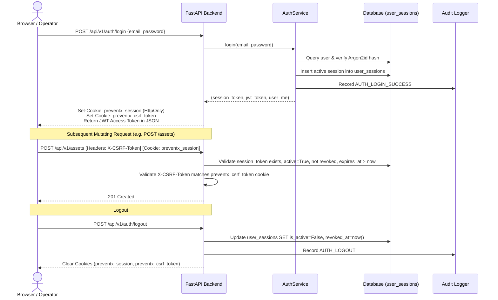

# Authentication & Session Security Design

## 1. Password Security with Argon2id
PREVENT-X implements **Argon2id**, the winner of the Password Hashing Competition (PHC) and recommended standard by OWASP and NIST.

### Cryptographic Parameters
- **Type**: `Argon2id` (hybrid of Argon2d and Argon2i, resistant to side-channel and GPU cracking attacks).
- **Time Cost (Iterations)**: 3
- **Memory Cost**: 65,536 KiB (64 MiB)
- **Parallelism**: 4 lanes / threads
- **Hash Length**: 32 bytes

Plaintext passwords are never logged, never cached in memory, and never persisted.

---

## 2. Session Management Lifecycle

---

## 3. Double-Submit CSRF Protection
To prevent Cross-Site Request Forgery while utilizing secure `HttpOnly` browser cookies:
1. Upon login, the backend issues an `HttpOnly` cookie (`preventx_session`) and a client-readable cookie (`preventx_csrf_token`).
2. The frontend reads `preventx_csrf_token` and includes it in the `X-CSRF-Token` HTTP header on all mutating requests (`POST`, `PUT`, `PATCH`, `DELETE`).
3. `CSRFMiddleware` verifies that the `X-CSRF-Token` header exactly matches the `preventx_csrf_token` cookie via constant-time string comparison (`hmac.compare_digest`).
4. Requests using explicit `Authorization: Bearer <token>` are exempt from CSRF checks because web browsers do not automatically attach custom Authorization headers cross-origin.
