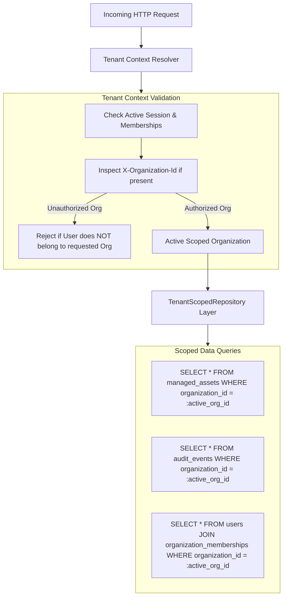

# Multi-Tenant SMB Data Isolation Design

## 1. Multi-Tenancy Architecture
Indian SMBs operating on PREVENT-X require absolute data separation. A security flaw in one SMB's configuration or a compromised account must never expose or modify another SMB's assets, virtual patch rules, or audit trails.

PREVENT-X achieves this through a **discriminator-column tenant isolation architecture** combined with **defense-in-depth authorization checks**:

---

## 2. Strict Tenant Boundaries

1. **Organization Context Dependency (`get_current_organization`)**:
   - Resolves the active organization from session context or client header (`X-Organization-Id`).
   - Validates that the authenticated user possesses an active membership in the target organization.
   - If a non-superuser attempts to specify an organization they do not belong to, access is immediately blocked with HTTP `403 Forbidden` (`TENANT_ACCESS_DENIED`).

2. **Tenant Scoped Repositories (`TenantScopedRepository`)**:
   - All tenant-owned tables (`managed_assets`, `vulnerability_records`, `virtual_patch_rules`, `audit_events`) inherit from `TenantScopedRepository`.
   - Every lookup method (`get_by_id_scoped`, `get_all_scoped`, `count_scoped`) requires `organization_id`.
   - Even if an attacker guesses the UUID of another tenant's asset, the query `WHERE id = :id AND organization_id = :active_org_id` returns `None`, resulting in HTTP `404 Not Found`.

3. **Cross-Tenant Attack Test Verification**:
   - Automated tests in `backend/tests/test_tenant_isolation.py` explicitly execute:
     - Cross-tenant asset read attacks (Tenant A user requests Tenant B asset ID).
     - Cross-tenant asset deletion attacks.
     - Cross-tenant asset modification attacks.
     - Tenant header spoofing attacks (`X-Organization-Id` pointing to an unauthorized tenant).
     - Cross-tenant user listing leakage tests.
   - All cross-tenant attacks are verified to fail and be recorded in the audit trail.

