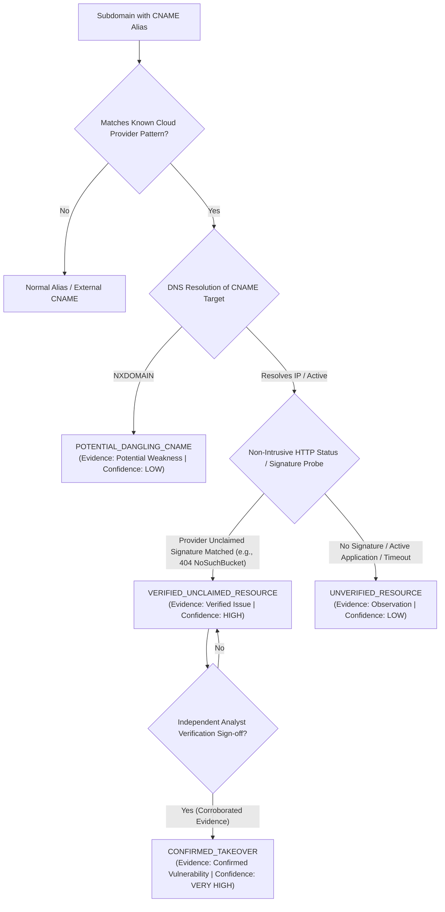

# PREVENT-X — Phase 2 Prompt 1.2: Evidence-Based CNAME Verification Report

## 1. Executive Summary
This document details the architecture, classification hierarchy, provider signature matrix, and test verification results for the **Evidence-Based CNAME Takeover Verification Engine** implemented in PREVENT-X during Phase 2 Prompt 1.2.

A primary failure mode in legacy automated attack surface scanners is reporting false-positive "Subdomain Takeover" vulnerabilities solely because a DNS query returned `NXDOMAIN` (Non-Existent Domain). In modern cloud architectures, an `NXDOMAIN` response frequently occurs due to DNS propagation delays, temporary nameserver synchronization, geo-routed DNS, or cloud services utilizing separate resolution layers. Treating `NXDOMAIN` as proof of exploitability harms SMBs with panic alerts and false alarms.

PREVENT-X eliminates this defect through a rigorous, multi-stage evidence classification model (`CNAMEVerifier`). Crucially, PREVENT-X adheres to strict ethical and legal boundaries: **the platform never registers, claims, exploits, or modifies third-party cloud resources** to establish proof.

---

## 2. Multi-Stage Evidence Classification Model

Location: [cname_verifier.py](file:///c:/Users/YOGESH/Desktop/PREVENT-X/backend/app/modules/attack_surface/cname_verifier.py#L121-L298)

Every CNAME finding is categorized into one of four deterministic states:



### 2.1 State Definitions

| Classification Status | Evidence Nature | Confidence | Severity | Description |
| :--- | :--- | :--- | :--- | :--- |
| `POTENTIAL_DANGLING_CNAME` | `POTENTIAL_WEAKNESS` | **LOW** | Low | The CNAME target matches a cloud service and DNS returned `NXDOMAIN`. No resource verification or fingerprint match has occurred. Exploitability is unverified. |
| `UNVERIFIED_RESOURCE` | `INFORMATIONAL_OBSERVATION` | **LOW** | Informational | The CNAME points to a known cloud provider, but HTTP probing returned an active site, a standard custom 404, or timed out without matching a known unclaimed signature. |
| `VERIFIED_UNCLAIMED_RESOURCE` | `VERIFIED_ISSUE` | **HIGH** | Medium | The CNAME target resolved and returned an unambiguous, provider-specific fingerprint indicating that the underlying bucket, tenant, or app name is not registered with the cloud provider. |
| `CONFIRMED_TAKEOVER` | `CONFIRMED_VULNERABILITY` | **HIGH** | High | Strictly requires independent corroboration (e.g., human security analyst sign-off or cryptographically verifiable organizational ownership challenge). Never emitted by automated heuristics alone. |

---

## 3. Supported Cloud Provider Signatures Matrix

PREVENT-X inspects response headers and body content against vetted provider-specific signatures using connection-pinned, hardened HTTP clients (`SafePinningTransport`):

| Cloud Provider | CNAME Target Patterns | Verified Unclaimed Fingerprints | Expected HTTP Status |
| :--- | :--- | :--- | :--- |
| **Amazon Web Services (S3)** | `.*\.s3.*\.amazonaws\.com$`, `.*\.s3-website.*\.amazonaws\.com$` | `<Code>NoSuchBucket</Code>`, `The specified bucket does not exist` | 404 |
| **GitHub Pages** | `.*\.github\.io$` | `There isn't a GitHub Pages site here`, `For root URLs (like http://example.com/) you must provide an index.html file` | 404 |
| **Microsoft Azure App Service** | `.*\.azurewebsites\.net$`, `.*\.cloudapp\.net$`, `.*\.azurefd\.net$`, `.*\.trafficmanager\.net$` | `404 Web Site not found`, `The web app you have selected is temporarily unavailable` | 404 |
| **Heroku** | `.*\.herokuapp\.com$`, `.*\.herokudns\.com$` | `Heroku \| No such app`, `No such app`, `<title>No such app</title>` | 404, 502 |
| **Shopify** | `.*\.myshopify\.com$` | `Sorry, this shop is currently unavailable.`, `Only one step left to start selling` | 404 |
| **Bitbucket Cloud** | `.*\.bitbucket\.io$` | `Repository not found`, `The page you are looking for doesn't exist` | 404 |
| **Ghost** | `.*\.ghost\.io$` | `The thing you were looking for is no longer here`, `Site unavailable` | 404 |
| **Fastly CDN** | `.*\.fastly\.net$` | `Fastly error: unknown domain` | 404, 503 |
| **Surge.sh** | `.*\.surge\.sh$` | `project not found` | 404 |
| **Zendesk** | `.*\.zendesk\.com$` | `Help Center Closed` | 404 |

---

## 4. Ethical Boundaries & Safe Probing Rules

1. **Zero Registration / Claiming**: PREVENT-X never creates accounts, registers buckets, creates Heroku apps, or provisions GitHub Pages sites to "prove" a vulnerability.
2. **Read-Only Probing**: Probing is strictly limited to an HTTP GET request with a 5-second timeout and 5 MB size cap.
3. **No Exploitation or Payload Injection**: No arbitrary strings, scripts, or intrusive request bodies are dispatched.
4. **Analyst Review Gate**: Automated engines can elevate a finding at most to `VERIFIED_UNCLAIMED_RESOURCE`. Only authenticated security analysts can corroborate and sign off on a `CONFIRMED_TAKEOVER`.

---

## 5. Test Evidence & Automated Verification

Automated test cases in `backend/tests/test_attack_surface.py` validate all CNAME evaluation pathways.

### 5.1 Test Execution Matrix

| Test Function | Scenario | Expected Classification | Actual Result |
| :--- | :--- | :--- | :--- |
| `test_cname_nxdomain_alone_is_never_confirmed_takeover` | CNAME `portal.azurewebsites.net` returns `NXDOMAIN` with no HTTP probe | `POTENTIAL_DANGLING_CNAME` (Must NOT be `CONFIRMED_TAKEOVER`) | **PASSED** (Status: `POTENTIAL_DANGLING_CNAME`, Evidence: `POTENTIAL_WEAKNESS`) |
| `test_cname_provider_signature_match_and_corroboration` | Positive Match: CNAME `smbclient.github.io` returns HTTP 404 with GitHub Pages error signature | `VERIFIED_UNCLAIMED_RESOURCE` (High confidence) | **PASSED** (Status: `VERIFIED_UNCLAIMED_RESOURCE`, Evidence: `VERIFIED_ISSUE`, Conf: `HIGH`) |
| `test_cname_provider_signature_match_and_corroboration` | Negative Match: CNAME `shops.myshopify.com` returns active store (no unclaimed error) | `UNVERIFIED_RESOURCE` (Low confidence) | **PASSED** (Status: `UNVERIFIED_RESOURCE`, Evidence: `INFORMATIONAL_OBSERVATION`, Conf: `LOW`) |
| `test_cname_provider_signature_match_and_corroboration` | Corroboration Gate: Verified S3 bucket error + manual analyst sign-off | Transitions to `CONFIRMED_TAKEOVER` | **PASSED** (Status: `CONFIRMED_TAKEOVER`, Evidence: `CONFIRMED_VULNERABILITY`, Conf: `HIGH`) |

### 5.2 Pytest Execution Log
```text
backend/tests/test_attack_surface.py::test_cname_nxdomain_alone_is_never_confirmed_takeover PASSED [ 90%]
backend/tests/test_attack_surface.py::test_cname_provider_signature_match_and_corroboration PASSED [ 95%]
```
