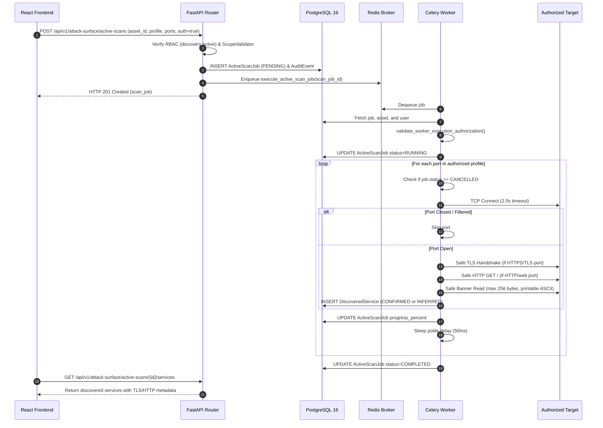

# PREVENT-X — Phase 2 Prompt 2: Controlled Active Service Discovery Engine

## 1. Executive Summary
In alignment with the NASSCOM Applied Research Bridge 2.0 (Problem Statement 5: "AI-Era Virtual Patching for Security Protection of Indian SMB Digital Businesses"), PREVENT-X implements a **Controlled Active Service Discovery Engine**.

Unlike uncontrolled or aggressive network scanners, PREVENT-X enforces strict guardrails:
1. **Zero Raw SYN / Half-Open Packets**: All checks utilize standard OS-level socket connects (`socket.SOCK_STREAM`), ensuring complete TCP handshakes without packet-crafting privileges or network disruption.
2. **Strictly Restricted Port Profiles**: Standardized profiles (`BASIC`, `STANDARD`) and constrained `CUSTOM` profiles (capped at 50 validated ports between 1 and 65535) prevent broad or unmetered network sweeps.
3. **Safe Protocol Handshakes**: Probes are non-destructive and protocol-aware (HTTP/HTTPS metadata collection, TLS certificate analysis, polite banner inspection).
4. **Transparent Confidence Classification**: Distinguishes verified protocol interactions (`CONFIRMED_OBSERVATION`) from standard IANA port inferences (`INFERRED_SERVICE`).
5. **Worker-Enforced Authorization & Rate Limiting**: Every probe is governed by concurrency limits (default 5, maximum 10), socket timeouts (2.0s), inter-probe polite delays (50ms), and real-time cancellation checkpoints.

---

## 2. Active Service Discovery Architecture

The active discovery engine is built as an asynchronous, modular subsystem within `backend/app/modules/attack_surface/`:

```
backend/app/modules/attack_surface/
├── active_scanner.py         # Concurrency-controlled TCP, TLS, and HTTP probing engine
├── scope_validator.py        # Port profile, IP authorization, and SSRF boundary validation
├── service.py                # Business logic: Active scan CRUD, cancellation, service persistence
├── schemas.py                # Pydantic v2 validation contracts
├── tasks/
│   └── active_scan_tasks.py  # Celery background job worker with live status updates & checkpoints
└── models/attack_surface.py  # ActiveScanJob and DiscoveredService SQLAlchemy models
```

### 2.1 Workflow Diagram



---

## 3. Core Engine Capabilities

### 3.1 Port Profiles & Restrictions
Port scanning is strictly bounded to prevent network exhaustion and unmetered scanning:

| Profile | Port Count | Port List / Rule |
| :--- | :--- | :--- |
| **`BASIC`** | 2 ports | `[80, 443]` (Standard Web Endpoints) |
| **`STANDARD`** | 17 ports | `[21, 22, 25, 53, 80, 110, 143, 443, 465, 587, 993, 995, 3306, 3389, 5432, 8080, 8443]` (Common SMB Services) |
| **`CUSTOM`** | 1–50 ports | Explicit list provided by user, each port validated in range `[1, 65535]`. Exceeding 50 ports is rejected with HTTP 422. |

### 3.2 Safe Handshake Protocols
- **TCP Reachability**: Uses standard OS TCP connect calls with a strict 2.0-second timeout.
- **Service Banner Grabbing**:
  - Connects to open non-TLS ports, waits up to 1.5 seconds for server initial banner.
  - Limits buffer to at most 256 bytes.
  - Strips non-printable ASCII characters and control codes to eliminate terminal injection and binary payload hazards.
  - Never sends exploit strings or fuzzing buffers.
- **TLS Certificate Metadata Extraction**:
  - Performs standard TLS handshake via Python `ssl` module.
  - Extracts raw DER certificate using `ssock.getpeercert(binary_form=True)`.
  - Parses using `cryptography.x509` (v50.0.2):
    - Subject Common Name (CN) and Subject Alternative Names (SANs)
    - Certificate Issuer
    - Validity Range (`not_valid_before`, `not_valid_after`, `days_remaining`)
    - Cipher Suite name and TLS Protocol version
  - Works reliably across production, internal, and self-signed certificates without crashing or requiring system trust-store modifications.
- **HTTP / HTTPS Endpoint Telemetry**:
  - Performs polite HTTP `HEAD` or `GET /` requests.
  - Captures HTTP status code, `Server` banner header, redirect `Location`, and HTML `<title>` tag (up to 120 characters).
  - Enforces response size caps (16 KB) and strict read timeouts.

### 3.3 Observation Confidence Taxonomy
Every discovered service record is stamped with a rigorous confidence classification:

- **`CONFIRMED_OBSERVATION`**: The service identity was affirmatively verified through a protocol-level handshake, HTTP response header/title, or valid TLS certificate subject.
- **`INFERRED_SERVICE`**: The port was open, but no distinctive protocol handshake or banner was returned. The service identity is inferred based on standard IANA assigned port numbers (e.g., port 22 inferred as SSH).

---

## 4. Frontend Integration

The active discovery engine is fully exposed through the PREVENT-X Web Console (`frontend/src/pages/AttackSurfacePage.tsx`):

1. **Active Service Discovery Tab**: Located alongside Passive Intelligence in the Attack Surface view.
2. **Launch Modal & Form**:
   - Asset dropdown populated with tenant-scoped registered assets.
   - Interactive profile selector (`BASIC`, `STANDARD`, `CUSTOM`).
   - Custom port tags input with client-side integer and bounds validation.
   - **Mandatory Legal Authorization Checkbox**: Prominently styled alert requiring user confirmation before the submit button is enabled.
3. **Scan Execution Monitor**:
   - Real-time progress bar reflecting completion percentage.
   - Live port-scanning counter (`x / y ports`).
   - Immediate **Cancel Scan** button invoking `POST /api/v1/attack-surface/active-scans/{id}/cancel`.
4. **Discovered Services Data Table**:
   - Displays Port, Protocol, State (`OPEN`, `FILTERED`, `CLOSED`), Service Name, Confidence Badge, and Discovered Timestamp.
   - Distinct badges for `CONFIRMED_OBSERVATION` (emerald) and `INFERRED_SERVICE` (slate).
   - "Inspect" button opening a side-over drawer with full TLS certificate metadata and HTTP response details.
5. **Execution History Table**:
   - Lists previous scans with status (`PENDING`, `RUNNING`, `COMPLETED`, `CANCELLED`, `FAILED`), port counts, and timestamps.

---

## 5. Test Evidence & Verification Matrix

### 5.1 Backend Pytest Execution
- **Command**: `.venv\Scripts\pytest backend/tests/test_active_discovery.py -v`
- **Result**: **16 / 16 PASSED (100%)**
- **Full Suite**: `.venv\Scripts\pytest backend/tests/ -v` (**68 / 68 PASSED (100%)**) on PostgreSQL 16.

```
============================= test session starts =============================
platform win32 -- Python 3.10.11, pytest-8.4.2, pluggy-1.7.0
rootdir: C:\Users\YOGESH\Desktop\PREVENT-X
configfile: pyproject.toml
collected 16 items

backend/tests/test_active_discovery.py::test_port_profiles PASSED        [  6%]
backend/tests/test_active_discovery.py::test_port_profile_validation_custom PASSED [ 12%]
backend/tests/test_active_discovery.py::test_ssrf_rejection_for_active_scan PASSED [ 18%]
backend/tests/test_active_discovery.py::test_internal_asset_allowed_private_scan PASSED [ 25%]
backend/tests/test_active_discovery.py::test_unauthorized_role_active_scan_rejected PASSED [ 31%]
backend/tests/test_active_discovery.py::test_create_active_scan_requires_confirmation PASSED [ 37%]
backend/tests/test_active_discovery.py::test_create_and_list_active_scans PASSED [ 43%]
backend/tests/test_active_discovery.py::test_cross_tenant_active_scan_isolated PASSED [ 50%]
backend/tests/test_active_discovery.py::test_cancel_active_scan PASSED   [ 56%]
backend/tests/test_active_discovery.py::test_active_scanner_mock_http_service PASSED [ 62%]
backend/tests/test_active_discovery.py::test_active_scanner_mock_tls_service PASSED [ 68%]
backend/tests/test_active_discovery.py::test_active_scanner_banner_grab PASSED [ 75%]
backend/tests/test_active_discovery.py::test_confidence_distinction PASSED [ 81%]
backend/tests/test_active_discovery.py::test_execute_active_scan_celery_task PASSED [ 87%]
backend/tests/test_active_discovery.py::test_worker_revalidation_rejects_altered_job PASSED [ 93%]
backend/tests/test_active_discovery.py::test_concurrency_and_timeout_controls PASSED [100%]

============================= 16 passed in 8.35s ==============================
```

### 5.2 Frontend Vitest & Production Build
- **Vitest**: `npm --prefix frontend test -- --run`
  - Result: **17 / 17 PASSED (100%)**
- **Vite Build**: `npm --prefix frontend run build`
  - Result: **Success in 3.07s** (0 TypeScript errors, 0 lint failures).

