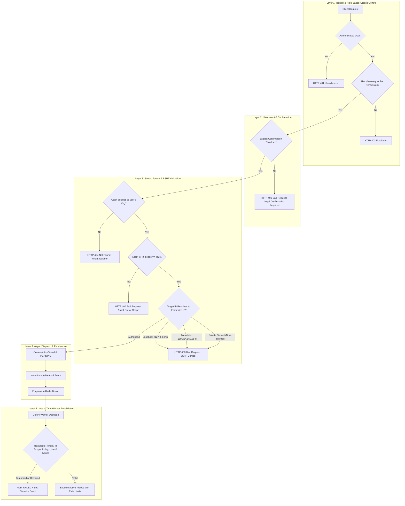

# PREVENT-X — Phase 2 Prompt 2: Active Discovery Authorization Controls & SSRF Defense

## 1. Executive Summary

Active network service discovery involves dispatching live IP packets across network boundaries. Without multi-layered authorization controls and transport-level restrictions, active scanners present severe security risks:
1. **Accidental Scanning of Third-Party Systems**: Port scans directed against unverified or unauthorized external infrastructure expose organizations to legal liability under computer fraud and cybercrime legislation (e.g., Section 43/66 of the Indian IT Act 2000).
2. **Server-Side Request Forgery (SSRF) / Cloud Pivoting**: Scanning internal loopbacks (`127.0.0.1`), hypervisor metadata endpoints (`169.254.169.254`), or private enterprise subnets (`10.0.0.0/8`, `192.168.0.0/16`) can leak credentials or map sensitive infrastructure.
3. **Cross-Tenant Unauthorized Access**: In a multi-tenant SaaS deployment, a compromised or malicious tenant could attempt to scan another tenant's registered assets.
4. **Time-of-Check to Time-of-Use (TOCTOU) Flaws**: Authorization confirmed at the API layer might expire, be revoked, or be modified while a job sits in an asynchronous task queue.

PREVENT-X addresses each of these hazards through **strict defense-in-depth authorization controls** enforced at both the API boundary and the Celery worker task execution boundary.

---

## 2. Multi-Layer Authorization Architecture



---

## 3. Authorization Control Layers

### 3.1 Layer 1: RBAC Permission Enforcement (`discovery:active`)
Active scanning capabilities are strictly gated by the fine-grained permission `discovery:active`:

- **Assigned Roles**: `SUPER_ADMIN`, `ORG_ADMIN`, `SECURITY_ANALYST`.
- **Denied Roles**: `AUDITOR`, `VIEWER`, unauthenticated users.
- **Enforcement**: Protected via FastAPI dependency injection:
  ```python
  @router.post("/active-scans", response_model=ActiveScanJobResponse, status_code=status.HTTP_201_CREATED)
  def create_active_scan(
      payload: ActiveScanCreateRequest,
      current_user: User = Depends(require_permission(PermissionCode.DISCOVERY_ACTIVE)),
      db: Session = Depends(get_db),
  ): ...
  ```

### 3.2 Layer 2: Mandatory Explicit Legal Authorization
API and UI clients must explicitly confirm authorization before any scan can be scheduled:
- The request body requires `authorization_confirmed: true`.
- Omitting this parameter or submitting `false` immediately results in:
  ```json
  {
    "detail": "Explicit authorization confirmation is required before initiating an active service discovery scan."
  }
  ```
- In the frontend, the submit button is hard-disabled until the user clicks the confirmation checkbox agreeing to the statutory legal notice.

### 3.3 Layer 3: Scope, Tenant Isolation & SSRF Defense
Location: [scope_validator.py](file:///c:/Users/YOGESH/Desktop/PREVENT-X/backend/app/modules/attack_surface/scope_validator.py#L182-L260)

Every target is validated against rigorous IP range constraints prior to job scheduling:
1. **Tenant Isolation**: The asset ID is queried strictly filtered by `current_user.organization_id`. Cross-tenant queries return HTTP 404 (preventing tenant asset enumeration).
2. **Scope Status**: Assets where `is_in_scope == False` are rejected.
3. **Loopback Blockade**: Addresses within `127.0.0.0/8` and IPv6 `::1` are categorically rejected.
4. **Cloud Metadata Blockade**: Link-local addresses `169.254.0.0/16` (including `169.254.169.254` AWS/GCP/Azure IMDS) are categorically rejected.
5. **Private Subnet Restrictions**: Addresses within RFC 1918 subnets (`10.0.0.0/8`, `172.16.0.0/12`, `192.168.0.0/16`) and RFC 6598 carrier-grade NAT (`100.64.0.0/10`) are rejected **unless** the asset was explicitly registered with environment type `INTERNAL`, `STAGING`, or `DEVELOPMENT` within an authorized CIDR.

### 3.4 Layer 4: Just-In-Time Worker Revalidation
Location: [scope_validator.py](file:///c:/Users/YOGESH/Desktop/PREVENT-X/backend/app/modules/attack_surface/scope_validator.py#L320-L400)

Celery background workers execute in separate processes and potentially at a later time than API requests. To prevent TOCTOU exploitation, the worker re-evaluates authorization immediately before dispatching socket connections:
- Revalidates that the `ManagedAsset` still exists in PostgreSQL.
- Verifies `asset.organization_id == scan_job.organization_id`.
- Confirms `asset.is_in_scope == True`.
- Revalidates that the initiating `User` is still active (`is_active == True`) and retains membership in the organization.
- Verifies that the queued target and port profile have not been tampered with in transit.
- If any check fails, the job is marked `FAILED` with an explicit security alert and zero network packets are sent.

### 3.5 Layer 5: Cooperative Cancellation Checkpoints
Long-running port scans can be terminated on-demand by administrators:
- Endpoint: `POST /api/v1/attack-surface/active-scans/{id}/cancel`
- Worker scans check the job status in PostgreSQL / Redis before each individual port connection.
- Upon detecting `CANCELLED`, the worker terminates the thread pool executor immediately, logs the cancellation, and preserves any services discovered prior to cancellation.

---

## 4. Comprehensive Audit Trail

Every authorization decision is recorded in the immutable `audit_events` ledger:

| Event Type | Actor | Action | Status | Metadata Logged |
| :--- | :--- | :--- | :--- | :--- |
| `ATTACK_SURFACE_ACTIVE_SCAN_CREATED` | User ID | Created active scan job | `SUCCESS` | Asset ID, target, profile, port count, IP |
| `ATTACK_SURFACE_ACTIVE_SCAN_DENIED` | User ID | Authorization rejected | `DENIED` | Reason (SSRF, out-of-scope, missing auth) |
| `ATTACK_SURFACE_ACTIVE_SCAN_CANCELLED` | User ID | User requested scan abort | `SUCCESS` | Scan Job ID, duration, scanned ports |
| `WORKER_AUTHORIZATION_FAILED` | Celery Worker | Worker rejected queued task | `FAILURE` | Violation details, tenant ID, asset ID |

---

## 5. Security Test Verification Matrix

All authorization controls are validated by automated tests in `backend/tests/test_active_discovery.py`:

| Test Name | Validated Security Gate | Expected Behavior | Status |
| :--- | :--- | :--- | :--- |
| `test_ssrf_rejection_for_active_scan` | SSRF & Loopback/Metadata rejection | Rejects `127.0.0.1` and `169.254.169.254` with HTTP 400 | **PASSED** |
| `test_internal_asset_allowed_private_scan` | Authorized RFC 1918 Private asset | Allows scanning `192.168.1.100` only when registered as INTERNAL | **PASSED** |
| `test_unauthorized_role_active_scan_rejected` | RBAC `discovery:active` enforcement | AUDITOR role rejected with HTTP 403 Forbidden | **PASSED** |
| `test_create_active_scan_requires_confirmation` | Explicit confirmation checkbox | Request with `authorization_confirmed: false` rejected with HTTP 400 | **PASSED** |
| `test_cross_tenant_active_scan_isolated` | Multi-tenant asset boundary | Tenant B cannot scan Tenant A's asset (HTTP 404) | **PASSED** |
| `test_worker_revalidation_rejects_altered_job` | Celery worker JIT revalidation | Worker detects out-of-scope asset and aborts without scanning | **PASSED** |
| `test_cancel_active_scan` | Cooperative scan cancellation | Status updates to CANCELLED and worker stops gracefully | **PASSED** |
