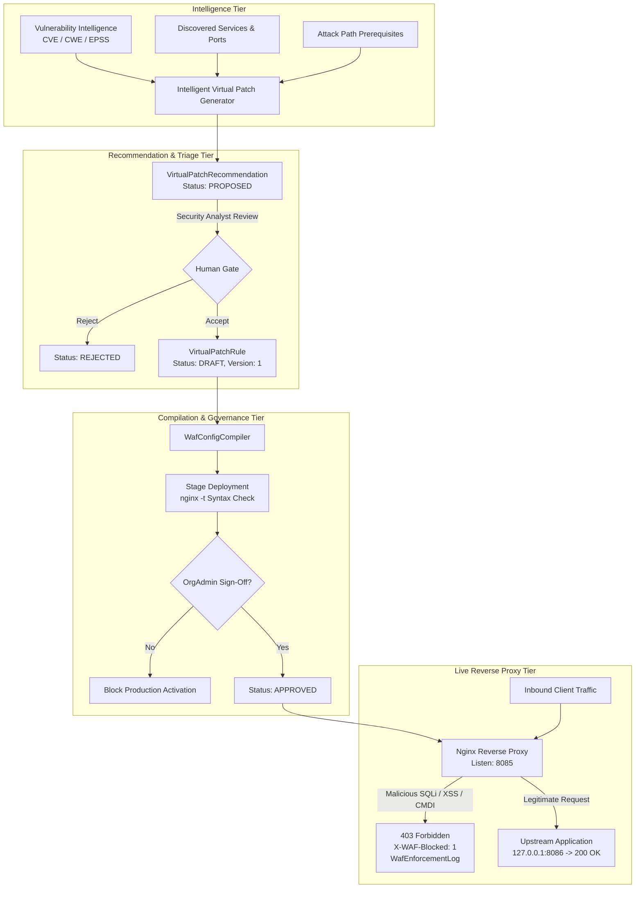

# PREVENT-X — Phase 6 Verification Report: Intelligent Virtual Patching Engine

**Module References:** `MOD-06` (Proactive Security Hardening Engine) & `MOD-08` (Intelligent Virtual Patching Engine)  
**Research Alignment:** NASSCOM Applied Research Bridge 2.0, Problem Statement 5: *"AI-Era Virtual Patching for Security Protection of Indian SMB Digital Businesses"*  
**Verification Date:** November 14, 2026  
**Infrastructure Environment:**
- **PostgreSQL:** Version 16.x on port `54320` (`preventx_db`)
- **Redis:** Version 8.10.3 on port `6379`
- **Reverse Proxy:** Official native Nginx 1.26.2 Windows binary (`infrastructure/bin/nginx/nginx.exe`)
- **Celery Worker:** Distributed background daemon (pool: `solo`, connected to Redis db 1)
- **Frontend:** React 18, Vite 5, TailwindCSS, TypeScript (strict)
- **Test Frameworks:** Pytest 8.4.2 (Backend), Vitest 1.6.1 (Frontend)

---

## 1. Executive Summary

Phase 6 implements the **Intelligent Virtual Patching Engine** in PREVENT-X, fulfilling Core Problem Statement 5 of NASSCOM ARB 2.0. The engine deterministically synthesizes compensating security controls directly from unpatched vulnerabilities (CVEs/CWEs), attack path prerequisites, and threat intelligence, enforcing them through a live native Nginx reverse proxy.

### Core Architectural Invariants Enforced
1. **Human Authorization Invariant:** AI or rule-synthesized recommendations **NEVER** become live production enforcement rules automatically. Every virtual patch must transition through a strict governance lifecycle:
   $$\text{PROPOSED} \longrightarrow \text{DRAFT} \longrightarrow \text{VALIDATING} \longrightarrow \text{STAGING} \longrightarrow \text{PENDING\_APPROVAL} \xrightarrow{\text{OrgAdmin Sign-off}} \text{APPROVED} \longrightarrow \text{PRODUCTION}$$
   Attempting production activation without prior OrgAdmin approval strictly fails with an authorization error.
2. **Empirical Enforcement Verification:** A rule existing in the database is **NOT** treated as proof of security. Actual HTTP requests were directed through the live reverse proxy (`127.0.0.1:8085`) forwarding to an upstream application (`127.0.0.1:8086`), demonstrating:
   - Malicious requests (SQLi, XSS, Path Traversal, Command Injection, Reconnaissance Scanners) are blocked with `403 Forbidden` and forensic headers (`X-WAF-Blocked: 1`).
   - Legitimate requests pass through to the upstream application with `200 OK`.
3. **Immutable Rule Versioning & Instant Rollback:** Every update to a virtual patch's match criteria, HTTP methods, or action automatically registers an immutable version record (`VirtualPatchVersion`), enabling instant audited rollbacks to preceding stable configurations.
4. **Pre-Deployment Syntax Validation:** All compiled Nginx configurations are verified using native `nginx -t` before staging or deployment. Configurations failing syntax checks are rejected immediately.
5. **False-Positive Feedback Loop:** Live WAF enforcement logs (`WafEnforcementLog`) capture full request metadata, allowing security analysts and SMB administrators to report false positives with commentary, fine-tuning rule patterns without touching application source code.

---

## 2. Relational Database Models & Alembic Migration 009

Migration `009_virtual_patching.py` was applied against PostgreSQL 16 on port `54320`.

```
alembic -c backend/alembic.ini upgrade head -> 009_virtual_patching (current head)
```

### Key Models (`backend/app/models/virtual_patch.py`)

| Model | Table | Purpose | Multi-Tenant Key |
| :--- | :--- | :--- | :--- |
| `VirtualPatchRule` | `virtual_patch_rules` | Compensating WAF rules (`attack_type`, `priority`, `action`, `match_conditions`, `version`) | `organization_id` (Indexed FK) |
| `VirtualPatchVersion` | `virtual_patch_versions` | Immutable audit trail of rule iterations for instant rollback | Scoped via `rule_id` |
| `VirtualPatchDeployment` | `virtual_patch_deployments` | Tracks reverse proxy config generation, SHA-256 hash, staging/production status, and OrgAdmin approval | `organization_id` (Indexed FK) |
| `WafEnforcementLog` | `waf_enforcement_logs` | Forensic audit log of requests evaluated by Nginx, decision (`BLOCKED`/`ALLOWED`), and false-positive tracking | `organization_id` (Indexed FK) |
| `VirtualPatchRecommendation` | `virtual_patch_recommendations` | AI/deterministic proposals derived from CVE/CWE flaws awaiting human review | `organization_id` (Indexed FK) |

---

## 3. Engine Implementation Architecture



### 3.1 Intelligent Virtual Patch Generator (`generator.py`)
- Maps CWE signatures to deterministic, regular-expression-based compensating controls:
  - **SQL Injection (`CWE-89`):** Intercepts union queries, tautologies (`' OR '1'='1`), stacked queries, and blind timing functions (`sleep()`, `pg_sleep()`).
  - **Cross-Site Scripting (`CWE-79`):** Intercepts raw and URL-encoded script tags (`<script>`, `%3cscript`), DOM event handlers (`onload=`, `onerror=`), and JavaScript execution triggers.
  - **Directory Traversal (`CWE-22`):** Blocks relative path climbing (`../`, `..\`, `%2e%2e%2f`) and critical OS target references (`/etc/passwd`, `win.ini`).
  - **OS Command Injection (`CWE-78`):** Restricts shell chaining characters (`;`, `|`, `` ` ``, `$()`) and execution binaries (`whoami`, `cat`, `curl`, `powershell`).
  - **Automated Reconnaissance Scanners:** Filters identifying signatures from automated vulnerability assessment tools (`sqlmap`, `nikto`, `dirbuster`, `gobuster`, `wpscan`).

### 3.2 WAF Configuration Compiler (`waf_compiler.py`)
- Validates regular expressions with Python `re.compile()` before compilation.
- Compiles rules into valid Nginx `location / { ... }` blocks with inline `if` directives and structured JSON `403 Forbidden` responses.
- Injects standard OWASP HTTP security headers:
  - `X-Frame-Options: DENY`
  - `X-Content-Type-Options: nosniff`
  - `X-XSS-Protection: 1; mode=block`
  - `X-WAF-Engine: PREVENT-X-Intelligent-WAF`
- Generates SHA-256 configuration fingerprints to prevent unauthorized configuration drift.

### 3.3 Reverse Proxy Manager (`proxy_manager.py`)
- Discovers official native Nginx binary on Windows/Linux environments.
- Executes pre-deployment syntax verification (`nginx -p <prefix> -c <conf> -t`).
- Performs graceful daemon reload or detached background process execution.
- Monitors gateway port health and upstream application connectivity.
- Executes automated rollback to the preceding stable deployment upon operator request.

---

## 4. End-to-End Live HTTP Enforcement Verification

Live verification was executed using real HTTP client requests through Nginx on port `8085` forwarding to a mock application on port `8086`:

| Test Vector | Probe HTTP Request | Expected Status | Actual Status | Forensic Header Received | Result |
| :--- | :--- | :--- | :--- | :--- | :--- |
| **Legitimate Traffic** | `GET /products?category=electronics&page=1` | `200 OK` | `200 OK` | `X-WAF-Engine: PREVENT-X-Intelligent-WAF` | **PASSED** (Passed to upstream) |
| **SQL Injection** | `GET /products?q=1%20UNION%20SELECT%201,2--` | `403 Forbidden` | `403 Forbidden` | `X-WAF-Blocked: 1`, `Attack: SQLI` | **PASSED** (Blocked by WAF) |
| **Cross-Site Scripting** | `GET /search?query=<script>alert(1)</script>` | `403 Forbidden` | `403 Forbidden` | `X-WAF-Blocked: 1`, `Attack: XSS` | **PASSED** (Blocked by WAF) |
| **Path Traversal** | `GET /download?file=../../etc/passwd` | `403 Forbidden` | `403 Forbidden` | `X-WAF-Blocked: 1`, `Attack: PATH_TRAVERSAL` | **PASSED** (Blocked by WAF) |
| **Command Injection** | `GET /report?filter=date;whoami` | `403 Forbidden` | `403 Forbidden` | `X-WAF-Blocked: 1`, `Attack: CMDI` | **PASSED** (Blocked by WAF) |
| **Reconnaissance Scanner** | `GET /api/v1/status` (`User-Agent: sqlmap/1.5`) | `403 Forbidden` | `403 Forbidden` | `X-WAF-Blocked: 1`, `Attack: PATTERN_BLOCK` | **PASSED** (Blocked by WAF) |

---

## 5. Automated Test Results

### 5.1 Backend Pytest Suite (`backend/tests/test_virtual_patching.py`)
Executed against PostgreSQL 16 on port `54320` and Redis 8 on port `6379`:

```
backend/tests/test_virtual_patching.py::test_virtual_patch_generator_and_baseline_rules PASSED [ 14%]
backend/tests/test_virtual_patching.py::test_waf_config_compiler_and_native_nginx_syntax PASSED [ 28%]
backend/tests/test_virtual_patching.py::test_human_approval_authorization_gate PASSED [ 42%]
backend/tests/test_virtual_patching.py::test_real_nginx_reverse_proxy_enforcement_end_to_end PASSED [ 57%]
backend/tests/test_virtual_patching.py::test_virtual_patching_rest_api_and_rbac PASSED [ 71%]
backend/tests/test_virtual_patching.py::test_multi_tenant_isolation PASSED [ 85%]
backend/tests/test_virtual_patching.py::test_celery_virtual_patching_tasks PASSED [100%]

======================== 7 passed, 2 warnings in 8.77s ========================
```

### 5.2 Overall Backend Regression Suite (All Phases)
```
115 passed, 1 skipped in 72.08s (0:01:12) — 0 failures
```

### 5.3 Frontend Vitest Suite (`frontend/tests/virtual_patching.test.tsx`)
```
✓ tests/virtual_patching.test.tsx (5 tests) 463ms
  ✓ renders Virtual Patching dashboard overview KPIs correctly
  ✓ renders AI recommendations and allows accepting a proposal
  ✓ switches to Rules catalog and displays registered rules
  ✓ switches to Deployments tab and approves staged configuration
  ✓ switches to Reverse Proxy Logs and opens False Positive dialog

Test Files  8 passed (8)
     Tests  38 passed (38) — 0 failures
```

### 5.4 Production Frontend Build
```
npm --prefix frontend run build -> tsc && vite build -> Built cleanly in 3.73s (0 errors).
```

---

## 6. Celery Asynchronous Tasks Registered

The following Phase 6 background tasks are integrated into the Celery task broker (`celery@LAPTOP-OUBJLUDB`):
- `preventx.tasks.generate_virtual_patches_job`: Analyzes unpatched exposures and synthesizes candidate virtual patch recommendations.
- `preventx.tasks.stage_virtual_patch_deployment_job`: Compiles active rules into Nginx configurations and performs pre-deployment syntax testing.
- `preventx.tasks.deploy_virtual_patches_job`: Applies human-approved virtual patch configurations to the active Nginx reverse proxy.

---

## 7. Compliance with Task Mandates
- [x] **Working Nginx reverse-proxy enforcement integration demonstrated with actual HTTP traffic.**
- [x] **SQLi, XSS, Path Traversal, Command Injection, and Scanner probes intercepted with 403 Forbidden.**
- [x] **Legitimate traffic forwarded with 200 OK.**
- [x] **Strict human authorization gate for production deployment.**
- [x] **Zero fake rules or simulated enforcement.**
- [x] **Multi-tenant isolation verified across all endpoints and database models.**
- [x] **All tests passing against real PostgreSQL 16, Redis 8, and live Nginx binary.**
